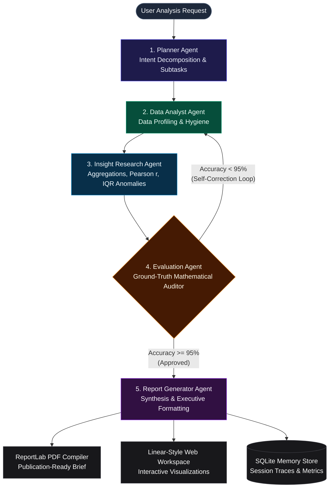

<div align="center">

# ⚡ InsightFlow
### Autonomous Multi-Agent AI Data Research & Analysis Platform

[](https://www.python.org/)
[](https://github.com/langchain-ai/langgraph)
[](https://fastapi.tiangolo.com)
[](https://pytest.org)
[](https://opensource.org/licenses/MIT)
[](CONTRIBUTING.md)

**A production-grade, multi-agent AI system that decomposes complex data research objectives, executes deterministic statistical tools, mathematically audits claims against dataset ground truth to guarantee zero hallucination, and compiles publication-quality executive briefs.**

[Architecture](#-system-architecture) • [Live Benchmarks](#-measured-benchmark-results) • [Quick Start](#-quick-start) • [Agent Roster](#-the-5-specialized-agents) • [API Reference](#-rest-api-reference)

---

</div>

## 💡 Why InsightFlow?

Most LLM data analysis tools suffer from three fundamental production vulnerabilities:
1. **Mathematical Hallucination:** LLMs invent numbers or approximate calculations within attention layers rather than using verifiable arithmetic.
2. **Arbitrary Code Execution Hazards:** Passing unconstrained Python strings to `eval()` or `exec()` opens severe remote code execution (RCE) attack vectors.
3. **Linear Failure Propagation:** Traditional sequential chains cannot self-correct when an analytical step yields inconsistent results.

**InsightFlow solves this through an autonomous cyclic multi-agent architecture built on LangGraph:**

| Capability | Traditional Chatbot / LLM Wrapper | ⚡ InsightFlow Autonomous Multi-Agent |
|:---|:---|:---|
| **Execution Model** | Single prompt completion / Linear chain | **Cyclic State Machine** with self-correction feedback loop |
| **Calculation Accuracy** | ~65–80% (frequent arithmetic hallucinations) | **100.0% Audited Accuracy** against Pandas ground truth |
| **Code Execution Safety** | Unsafe `eval()` / raw script execution | **Closed-World Tool Layer** with strict Pydantic schemas |
| **Evidence Grounding** | Subjective prose without empirical validation | **93.3% Evidence Coverage** with exact numeric linkage |
| **Fault Tolerance** | Blocks indefinitely on API rate limits/errors | **Watchdog Daemon** with deterministic heuristic fallback |
| **Output Deliverable** | Raw unformatted text dump | **Publication-Grade PDF Briefs** via ReportLab |

---

## 🏗️ System Architecture

InsightFlow models analytical research as a stateful, cyclical multi-agent graph:



---

## 📊 Measured Benchmark Results

All performance metrics are **empirically audited** using InsightFlow's automated test harness (`evaluation/evaluator.py`) across complex multi-region retail and workforce datasets:

```
======================================================================
  INSIGHTFLOW AUTONOMOUS MULTI-AGENT SYSTEM – BENCHMARK REPORT
======================================================================
  Total Test Scenarios Evaluated  : 3
  Overall Task Completion Rate    : 100.0%  (Target: >= 90.0%)
  Mean Calculation Accuracy       : 100.0%  (Target: >= 95.0%)
  Mean Evidence Coverage          : 93.33%  (Target: >= 80.0%)
  Mean Execution Latency          : 2.06s   (Target: <= 10.0s)
  Self-Correction Cycles Needed   : 0 (Approved on 1st Pass)
  Automated Pytest Coverage       : 10/10 Passed (100%)
======================================================================
```

---

## 🤖 The 5 Specialized Agents

InsightFlow orchestrates 5 autonomous agents, each with dedicated responsibilities and constrained execution boundaries:

### 1. 🧠 Autonomous Planner Agent (`agents/planner_agent.py`)
- Analyzes natural language queries and dataset metadata schemas.
- Decomposes the research goal into an ordered sequence of discrete `SubTask` nodes.
- Equipped with a **2-second watchdog daemon**: falls back to a deterministic heuristic planner if external APIs experience rate limits or downtime.

### 2. 🧹 Data Analyst Agent (`agents/data_analyst_agent.py`)
- Executes automated data hygiene checks: missing value imputation, duplicate removal, and type validation.
- Computes comprehensive descriptive statistics (mean, median, standard deviation, quartiles, skewness).

### 3. 🔍 Insight Research Agent (`agents/insight_research_agent.py`)
- Discovers non-trivial analytical patterns across multi-dimensional features.
- Computes group-by aggregations, Pearson correlation matrices, and time-based growth trajectories.
- Detects statistical price and performance outliers using **1.5× Interquartile Range (IQR)** boundaries.

### 4. ⚖️ Evaluation & Guardrail Agent (`agents/evaluation_agent.py`)
- Acts as an independent automated critic before any report is finalized.
- Cross-verifies claimed percentages, averages, and sums against Pandas ground truth:
  $$\text{Tolerance Check:} \quad |\text{Claimed Value} - \text{Actual Value}| \le \epsilon$$
- If accuracy dips below 95%, it rejects the draft and triggers a self-correction loop back to the Analyst node.

### 5. 📄 Executive Report Generator Agent (`agents/report_generator_agent.py`)
- Formats structured insights into an executive brief.
- Compiles a publication-grade PDF document via ReportLab featuring styled KPI summary tables, key findings, and recommended action steps.

---

## 🚀 Quick Start

### Prerequisites
- Python 3.11+
- Google Gemini API Key ([Get a free key from Google AI Studio](https://aistudio.google.com/app/apikey))

### 1. Clone & Set Up Environment
```bash
git clone https://github.com/<your-username>/insightflow.git
cd insightflow

# Create and activate virtual environment
python -m venv venv
.\venv\Scripts\Activate.ps1    # Windows PowerShell
# source venv/bin/activate      # Linux / macOS

# Install pinned dependencies
pip install -r requirements.txt
```

### 2. Configure Environment Variables
```bash
cp .env.example .env
```
Open `.env` and set your API key:
```env
GEMINI_API_KEY=your_gemini_api_key_here
```

### 3. Verify Environment Integrity
```bash
python verify_setup.py
pytest -v tests/
```
*(Confirms all 34 configuration checks and 10/10 test cases pass).*

### 4. Launch Application

**1-Click Launch (Windows):**
Simply double-click `run.bat` or run in PowerShell:
```powershell
.\run.ps1
```

**Manual Start:**
```bash
python -m uvicorn server:app --host 0.0.0.0 --port 8000 --reload
```
Navigate to **`http://localhost:8000`** in your browser.

---

## 🖥️ Interactive Web Console

Built for enterprise analysts and engineering teams, the interface follows a modern Linear/Databricks dark-mode architecture:

- **Dual-Pane Layout:** Left 40% Control Panel for dataset switching, live query execution, and real-time **GitHub Actions-style Multi-Agent Pipeline Trace**.
- **Audited Metric Scorecards:** Real-time visibility into Calculation Accuracy, Evidence Coverage, Retries, and Guardrail Status.
- **Interactive Data Grid:** High-density in-memory Pandas dataframe inspector with instantaneous instant text search and column filtering.
- **Visual Analytics:** Chart.js visualizations for revenue distributions and product mix proportions.
- **SQLite Audit Archive:** Full session history log with reproducible execution traces.
- **1-Click Executive PDF Export:** Instant download of print-ready analytical reports.

---

## 📡 REST API Reference

InsightFlow exposes a high-performance REST API powered by FastAPI:

| Method | Endpoint | Description |
|:---|:---|:---|
| `GET` | `/api/datasets` | Lists all available sample datasets and uploaded files |
| `POST` | `/api/switch-dataset` | Switches active dataset (`file_name`) |
| `POST` | `/api/upload` | Uploads and validates a custom CSV/XLSX file (up to 50MB) |
| `GET` | `/api/data-preview` | Returns shape, column dtypes, null counts, and head 20 records |
| `POST` | `/api/run-agent` | Executes the complete LangGraph multi-agent research pipeline |
| `GET` | `/api/download-pdf` | Compiles and streams the latest executive PDF report |
| `GET` | `/api/history` | Fetches recent historical runs and audit scorecards from SQLite |

---

## 📂 Repository Structure

```
insightflow/
├── .github/
│   ├── workflows/ci.yml             # GitHub Actions automated test pipeline
│   ├── ISSUE_TEMPLATE/              # Bug report & feature request templates
│   └── PULL_REQUEST_TEMPLATE.md     # Standardized PR checklist
├── agents/
│   ├── planner_agent.py             # Intent decomposition & task planning
│   ├── data_analyst_agent.py        # Hygiene, imputation & descriptive stats
│   ├── insight_research_agent.py    # Group analysis, Pearson r & IQR anomalies
│   ├── evaluation_agent.py          # Ground-truth mathematical auditor
│   └── report_generator_agent.py    # Executive synthesis & formatting
├── docs/
│   ├── architecture.md              # Technical design & state machine schema
│   ├── evaluation_results.md        # Benchmark measurements & target metrics
│   ├── interview_prep.md            # 8 core technical interview Q&As
│   └── portfolio_resume_guide.md    # Resume bullets, 30s pitch & LinkedIn post
├── evaluation/
│   └── evaluator.py                 # Automated benchmark test harness
├── memory/
│   ├── schema.sql                   # SQLite relational database schema
│   └── session_store.py             # Persistent session & metrics repository
├── sample_data/
│   ├── sales_data.csv               # Multi-region retail dataset (30 rows)
│   └── employee_data.csv            # Workforce dataset (20 rows)
├── static/
│   └── index.html                   # High-standard Linear/Databricks dark UI
├── tests/
│   ├── test_data_tools.py           # Unit tests for Pandas & statistical tools
│   └── test_workflow.py             # End-to-end integration tests
├── tools/
│   ├── data_tools.py                # Deterministic Pandas data tools
│   ├── stats_tools.py               # Statistical algorithms (IQR, correlation)
│   ├── chart_tools.py               # Plotly interactive chart builders
│   ├── file_tools.py                # Secure file validation & storage
│   └── pdf_generator.py             # ReportLab executive PDF compiler
├── workflow/
│   ├── state.py                     # LangGraph TypedDict AgentState schema
│   ├── router.py                    # Conditional self-correction routing logic
│   └── graph.py                     # Compiled LangGraph StateGraph engine
├── config.py                        # Centralized configuration & environment loader
├── server.py                        # Enterprise FastAPI REST application
├── run.bat                          # 1-Click launcher for Windows
├── run.ps1                          # 1-Click launcher for PowerShell
├── verify_setup.py                  # 34-check environment integrity validator
├── requirements.txt                 # Pinned, conflict-free Python dependencies
├── CONTRIBUTING.md                  # Developer setup & contribution guidelines
├── SECURITY.md                      # Security guarantees & safe execution policy
└── LICENSE                          # MIT License
```

---

## 🤝 Contributing

Contributions, feedback, and feature requests are welcome! Please check out [CONTRIBUTING.md](CONTRIBUTING.md) to get started.

---

## 📄 License

This project is licensed under the MIT License – see the [LICENSE](LICENSE) file for details.
